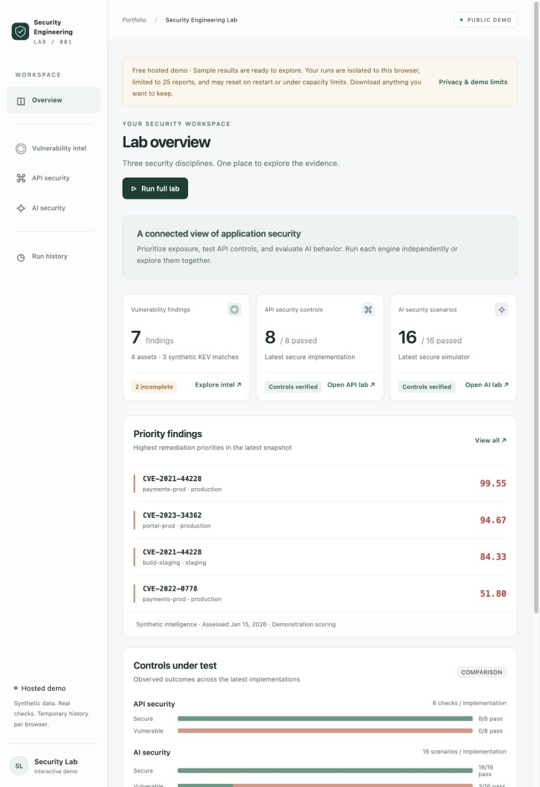
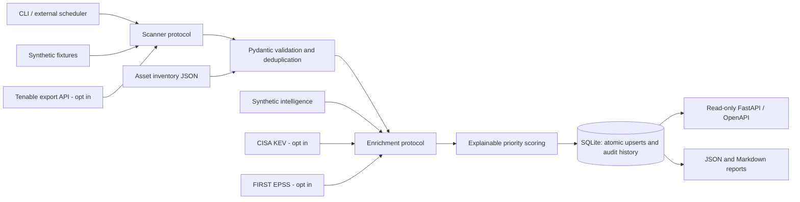

# Vulnerability Intelligence API

Python-based vulnerability intelligence API built as a security engineering and AI-assisted development project. It turns scanner observations into persistent, explainable remediation priorities through ingestion, threat enrichment, asset context, and a read-only REST API.

**An offline-first portfolio demonstration, not a production-ready vulnerability management platform.** All included assets, findings, KEV memberships, and EPSS probabilities are synthetic. CVE identifiers illustrate the workflow; the fixtures are not current threat intelligence. The scoring formula is a demonstration model, not a validated enterprise risk-scoring standard.

## Live portfolio demo

**[Explore Vulnerability intelligence in the live Security Engineering Lab](https://security-engineering-lab.onrender.com/#vulnerability)**

Explore seven synthetic findings, asset context, missing enrichment, and explainable remediation priorities.
The unified app combines this engine with the other two security projects using
pinned source snapshots. This repository remains the independent engine's source.

[](https://security-engineering-lab.onrender.com/#vulnerability)

*Hosted overview captured October 26, 2026; all displayed findings are synthetic.*
The public demo accepts no external targets or credentials. Free hosting can take
time to wake; browser-session history is temporary. Download reports you want to keep.

[Unified app source](https://github.com/Brrek/security-engineering-lab) ·
[Production and authorized bug bounty roadmap](https://github.com/Brrek/security-engineering-lab/blob/main/docs/production-roadmap.md)

## What works

- Pluggable scanner protocol, paginated synthetic provider, and optional Tenable Vulnerability Management export adapter with bounded polling and chunk downloads.
- Independently optional CISA KEV and FIRST EPSS enrichment, provenance dates, explicit unknown values, and deterministic offline fixtures.
- Explainable 0–100 priorities using CVSS, KEV, EPSS, asset criticality, environment, and finding age; configurable weights.
- SQLite assets, vulnerabilities, findings, enrichment metadata, and ingestion history; stable UUIDs, atomic publication, schema setup, and idempotent upserts.
- Validated FastAPI responses, pagination, severity/asset/priority filters, finding details, summary statistics, and ingestion status.
- Reproducible JSON and Markdown reports with priorities, asset exposure, KEV matches, remediation guidance, freshness, errors, and incomplete enrichment.
- Offline tests, Ruff, Bandit, and a coverage gate of **85%**, enforced in GitHub Actions on Python 3.12 and 3.13.

## Quick start

Requires Python 3.12+ and [uv](https://docs.astral.sh/uv/). Install dependencies once; the default application and tests then work without internet access or credentials.

```bash
git clone https://github.com/Brrek/vuln-intelligence-api.git
cd vuln-intelligence-api
uv sync --frozen --extra dev

uv run vuln-intel ingest --as-of 2026-01-15
# Exit 2 is intentional: seven findings were saved, but two lack intelligence.

uv run vuln-intel report --as-of 2026-01-15 --out reports
uv run vuln-intel serve
```

The server binds to **127.0.0.1:8000**. Browse [interactive OpenAPI docs](http://127.0.0.1:8000/docs) or [the schema](http://127.0.0.1:8000/openapi.json). The API never triggers ingestion or live requests.

Without uv, create a Python 3.12+ virtual environment and run `python -m pip install -e '.[dev]'`; use `vuln-intel` in place of `uv run vuln-intel`. That alternative resolves compatible dependencies rather than using `uv.lock`.

## Example API calls

```bash
curl -fsS http://127.0.0.1:8000/health
curl -fsS 'http://127.0.0.1:8000/findings?severity=critical&min_priority=90&limit=10&offset=0'
curl -fsS 'http://127.0.0.1:8000/findings?asset=payments-prod'
curl -fsS http://127.0.0.1:8000/findings/419a7ecf-615a-5a93-8a33-2160448a6cf8
curl -fsS 'http://127.0.0.1:8000/vulnerabilities?limit=2&offset=0'
curl -fsS 'http://127.0.0.1:8000/priorities?limit=3'
curl -fsS http://127.0.0.1:8000/ingestions/latest
curl -fsS 'http://127.0.0.1:8000/ingestions?limit=10&offset=0'
curl -fsS http://127.0.0.1:8000/stats
```

Pages return `items`, `total`, `limit`, and `offset`. Limits are 1–100. Finding pages sort by score descending, then stable identifier. Severity is one of `unknown`, `info`, `low`, `medium`, `high`, or `critical`; `min_priority` is 0–100. Invalid requests return 422, absent records 404, and unavailable databases 503 with sanitized messages. No API authentication is implemented: use only on a trusted local workstation.

## Verified synthetic example

A fresh ingestion receives **8 observations**, deduplicates one, and persists **7 findings**, **5 vulnerabilities**, and **4 assets**. Three findings have synthetic KEV matches; two have incomplete enrichment. Repeating ingestion adds history but does not add findings.

| Vulnerability | Asset | Score | Synthetic KEV | Synthetic EPSS |
|---|---|---:|---|---:|
| CVE-2021-44228 | payments-prod | 99.55 | true | 0.97 |
| CVE-2023-34362 | portal-prod | 94.67 | true | 0.94 |
| CVE-2021-44228 | build-staging | 84.33 | true | 0.97 |
| CVE-2022-0778 | payments-prod | 51.80 | false | 0.12 |

The first result contributes 30 CVSS + 25 KEV + 14.55 EPSS + 15 asset criticality + 10 environment + 5 age = **99.55**. Responses include these contributions, the weights, assessment date, and a textual explanation.

See the actual generated [Markdown report](examples/report.md) and [JSON report](examples/report.json). Reproduce them from a **fresh database with one ingestion**:

```bash
uv run vuln-intel --db data/example.db ingest --as-of 2026-01-15
# Expected exit 2; run the report command separately.
uv run vuln-intel --db data/example.db report --as-of 2026-01-15 --out generated
# On the first run against a fresh database, these are byte-identical:
diff examples/report.json generated/report.json
diff examples/report.md generated/report.md
```

The fixed date reproduces the example. Omit `--as-of` to score for today. Reports require the assessment date stored in the database; rerun ingestion to refresh scores. Historical live feed retrieval is not supported. Reports omit random run IDs and wall-clock execution timestamps, which remain available in ingestion history; changing the number of ingestions changes the report's audit counts.

## Architecture



Application modules live under `src/vuln_intelligence/`; fixtures are packaged with the application. See [technical decisions](docs/design.md), [threat model](docs/threat-model.md), and [verification record](docs/verification.md).

## Configuration and optional live integrations

`.env.example` documents safe defaults. The application reads process environment variables; it **does not automatically load `.env` files**. Set variables in your shell or use your scheduler's secret store. Never commit real scanner keys, asset inventory, live reports, or databases.

| Variable | Default | Meaning |
|---|---|---|
| `VULN_DB` | `data/vuln.db` | Local SQLite file; overridden by global `--db` |
| `VULN_ENABLE_LIVE` | `false` | Master opt-in gate for external integrations |
| `TENABLE_ACCESS_KEY` | unset | Tenable access key, only for its adapter |
| `TENABLE_SECRET_KEY` | unset | Tenable secret key, only for its adapter |

```bash
# Supply credentials securely in the process environment before this command.
VULN_ENABLE_LIVE=true uv run vuln-intel --db data/live.db ingest \
  --scanner tenable --intel live --context asset-context.json
```

Use a separate database for live data. See [asset context example](examples/asset-context.json); keys correspond to Tenable asset UUIDs. Unclassified assets default to criticality 3 and environment `unknown`, and responses disclose that default. The adapter requests OPEN and REOPENED findings. It does not infer remediation from absent observations. Live adapters are tested with realistic mocked contracts, **not verified against a live Tenable account**.

To exercise public feed integration against the synthetic scanner, explicitly select `--intel live` and set the gate. Failures of one intelligence source do not erase the other source's results; unknown data is labeled. Live mode never silently substitutes synthetic intelligence. Re-run ingestion to retry failed intelligence lookups.

Customize the score with `--weights examples/weights.json`. Weights must be nonnegative and sum to 100. The default model uses CVSS/10, KEV 0/1, EPSS 0–1, criticality/5, an environment multiplier, and age capped at 90 days. Unknown CVSS/KEV/EPSS contribute zero **with an explicit warning**; a low resulting score does not establish safety.

## Scheduled ingestion

The CLI is a one-shot scheduler target. For example, on a Linux demonstration host, adapt these paths in crontab:

```cron
0 6 * * * cd /path/to/vuln-intelligence-api && .venv/bin/vuln-intel ingest >> /path/to/private/ingestion.log 2>&1
```

No cron job is installed by this project. Use a dedicated writable directory, restrictive permissions, and a scheduler that prevents overlapping runs. The default remains offline. Exit codes are **0 completed**, **2 partial** (rejected records or incomplete enrichment), and **1 failed/configuration error**. A partial run persists valid findings and exposes the reason in history. Run `vuln-intel init` for schema setup without ingestion.

## Quality checks

```bash
uv run ruff check src tests
uv run ruff format --check src tests
uv run bandit -r src -q
uv run pytest
```

Tests exercise normalization, boundary validation, score calculations, deduplication, repeated ingestion, database persistence and rollback, API validation/pagination/filtering, report reproducibility, retry/rate-limit behavior, and independent intelligence failures. An autouse fixture blocks outbound socket connections. CI uses a locked dependency graph, read-only workflow permissions, and commit-pinned actions. Coverage includes first-party application modules and branches, with an enforced 85% floor.

## Scope and limitations

This is a small single-host service. It has no authentication, TLS termination, distributed queue, tenant isolation, automatic remediation, exploit verification, or validated business-risk model. Stored findings represent retained evidence, not a complete lifecycle of currently open vulnerabilities. Missing enrichment and unclassified assets need analyst review. Scores refresh on ingestion, not on API reads. SQLite and in-memory report aggregation have not been load-tested. There are no performance or production-readiness claims.

Review [SECURITY.md](SECURITY.md) before adapting it. Original repository history is retained; no proprietary company data is included.
